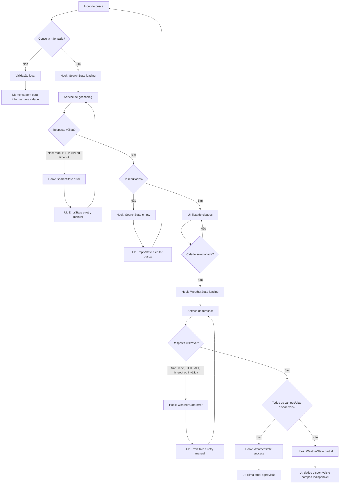

# Plano Técnico — Weather App

## Architecture

Aplicação web client-side em React, sem backend próprio. O navegador consulta diretamente a Open-Meteo, que não exige API key. A interface não persiste cidade, unidade ou consultas. Essa decisão evita infraestrutura e armazenamento de servidor; a localidade pesquisada é enviada ao provedor e deve ser divulgada na política de privacidade.

Responsabilidades:

- **UI (`src/components/`):** coleta a consulta, mostra resultados, clima, previsão e estados.
- **Hook (`src/hooks/`):** coordena busca, seleção, consulta meteorológica, estados e timeout.
- **Service (`src/services/`):** monta URLs, chama Open-Meteo, valida respostas e converte DTOs externos em modelos internos.
- **Utilitários (`src/lib/`):** conversão de temperatura, formatação local e tradução de códigos meteorológicos.
- **Tipos (`src/types/`):** contratos compartilhados entre service, hook e componentes.

Não haverá cache de servidor, conta ou serviço de persistência no MVP. Respostas antigas de buscas concorrentes serão ignoradas ou canceladas; somente a consulta mais recente pode atualizar a interface.

## Tech Stack

- **Linguagem:** TypeScript em modo strict.
- **Aplicação:** React 19 e Vite 8, conforme `package.json`.
- **Estilo:** Tailwind CSS 3, conforme a stack do repositório.
- **HTTP:** `fetch` nativo com `URLSearchParams` e `AbortController`; nenhuma dependência HTTP adicional.
- **Dados meteorológicos:** Open-Meteo Geocoding e Forecast APIs, sem API key.
- **Testes:** Vitest, Testing Library e Playwright, já presentes no projeto; mocks de rede via `vi.stubGlobal`/`page.route`.
- **Qualidade:** Biome; gerenciamento de pacotes com pnpm.

Não adicionar bibliotecas de estado, validação ou cache sem necessidade demonstrada. Validar manualmente os campos externos mínimos no service para tratar respostas parciais e inválidas.

## Project Structure

Estrutura-alvo alinhada às convenções do repositório:

```text
src/
  App.tsx
  components/
    SearchBar.tsx
    CurrentWeather.tsx
    ForecastList.tsx
    ForecastCard.tsx
    UnitToggle.tsx
    states/
      EmptyState.tsx
      ErrorState.tsx
      LoadingState.tsx
  hooks/
    useWeather.ts
  services/
    weatherService.ts
  lib/
    format.ts
    temperature.ts
    weatherCodes.ts
  types/
    weather.ts
  styles/
    index.css

tests/
  unit/
    weatherService.test.ts
    temperature.test.ts
    weatherCodes.test.ts
    format.test.ts
    SearchBar.test.tsx
    App.test.tsx
  e2e/
    weather.spec.ts
```

Manter um componente por arquivo, acesso externo isolado no service e funções de transformação puras. Reutilizar os arquivos de estado existentes quando possível, sem criar novas abstrações de layout.

## Data Model

Os dados internos mantêm temperaturas em Celsius; conversão acontece apenas na apresentação. Campos opcionais são `null`, nunca zero implícito.

```ts
export type TemperatureUnit = "celsius" | "fahrenheit";

export interface WeatherLocation {
  id: number | null;
  name: string;
  latitude: number;
  longitude: number;
  admin1: string | null;
  country: string | null;
  countryCode: string | null;
  timezone: string | null;
}

export type CitySearchResult = WeatherLocation;

export interface CurrentWeather {
  temperatureC: number | null;
  weatherCode: number | null;
  referenceTime: string | null;
}

export interface DailyForecast {
  date: string; // YYYY-MM-DD no fuso da localidade
  weatherCode: number | null;
  temperatureMinC: number | null;
  temperatureMaxC: number | null;
}

export interface WeatherSnapshot {
  location: WeatherLocation;
  current: CurrentWeather;
  daily: DailyForecast[]; // preservar datas/ordem retornadas
  retrievedAt: string; // ISO UTC, usado para diagnóstico, não como horário de observação
}

export type RequestErrorKind = "timeout" | "network" | "http" | "api" | "invalid-response";

export interface RequestError {
  kind: RequestErrorKind;
  statusCode?: number; // status HTTP, quando a falha vier de uma resposta HTTP
}

export type SearchState =
  | { status: "idle" }
  | { status: "loading"; query: string }
  | { status: "success"; query: string; results: CitySearchResult[] }
  | { status: "empty"; query: string }
  | { status: "error"; query: string; error: RequestError };

export type WeatherState =
  | { status: "idle" }
  | { status: "loading"; location: WeatherLocation }
  | { status: "success"; snapshot: WeatherSnapshot }
  | { status: "partial"; snapshot: WeatherSnapshot; missingFields: string[] }
  | { status: "error"; location: WeatherLocation; error: RequestError };
```

Os estados da busca e do clima são discriminados por `status`, impedindo combinações inválidas de flags e permitindo que cada tela trate explicitamente `idle`, `loading`, `success`/`partial`, `empty` e `error`.

## Data Flow

1. O usuário informa uma cidade; o app remove espaços externos e não envia consultas vazias.
2. `useWeather` inicia busca e define `loading`; `weatherService` chama geocoding com limite de dez resultados.
3. O usuário seleciona explicitamente um resultado. Resultados mostram nome, região e país disponíveis.
4. A seleção dispara uma consulta de previsão com latitude/longitude. Um identificador de requisição ou cancelamento impede respostas antigas de substituir a seleção mais recente.
5. O service valida e mapeia a resposta externa para `WeatherSnapshot`; conserva temperaturas em Celsius e datas no fuso retornado para a localização.
6. O hook define `success`, `partial` ou `error`; componentes exibem a condição resultante.
7. `App` mantém a unidade escolhida apenas em estado local. Componentes derivam e formatam as temperaturas a partir dos valores em Celsius durante a renderização; alternar unidade não chama o service nem altera o snapshot. Recarregar volta a Celsius.
8. Cada requisição termina em sucesso, erro ou timeout de dez segundos. Nova tentativa só ocorre por ação explícita do usuário.



## External APIs

### Open-Meteo Geocoding

- **URL:** `GET https://geocoding-api.open-meteo.com/v1/search?name=Berlin&count=10&language=pt&format=json`
- **Parâmetros relevantes:** `name` é a consulta já codificada; `count=10` limita resultados ao máximo da spec; `language=pt` solicita nomes em português quando disponíveis; `format=json` seleciona JSON.
- **Resposta resumida:**

```json
{
  "results": [
    {
      "id": 2950159,
      "name": "Berlin",
      "latitude": 52.52437,
      "longitude": 13.41053,
      "admin1": "Berlin",
      "country": "Germany",
      "country_code": "DE",
      "timezone": "Europe/Berlin"
    }
  ],
  "generationtime_ms": 0.2
}
```

- **Mapeamento para `WeatherLocation` / `CitySearchResult`:** `id` → `id`; `name` → `name`; `latitude`/`longitude` → coordenadas; `admin1` → `admin1`; `country` → `country`; `country_code` → `countryCode`; `timezone` → `timezone`. Campos ausentes ou nulos opcionais tornam-se `null`. `generationtime_ms` é metadado da resposta e não entra no modelo de cidade.
- **Sem resultados:** `results` ausente ou vazio resulta em `SearchState` com `status: "empty"`; não chamar Forecast até haver seleção explícita.

### Open-Meteo Forecast

- **URL:** `GET https://api.open-meteo.com/v1/forecast?latitude=52.52437&longitude=13.41053&current=temperature_2m%2Cweather_code&daily=weather_code%2Ctemperature_2m_max%2Ctemperature_2m_min&temperature_unit=celsius&timezone=auto&forecast_days=5`
- **Parâmetros relevantes:** `latitude`/`longitude` vêm da cidade selecionada; `current=temperature_2m,weather_code` solicita temperatura e código atuais; `daily=weather_code,temperature_2m_max,temperature_2m_min` solicita código, mínima e máxima diárias; `temperature_unit=celsius` mantém o modelo interno em Celsius; `timezone=auto` usa o fuso da coordenada; `forecast_days=5` solicita hoje e os quatro dias seguintes.
- **Resposta resumida:**

```json
{
  "latitude": 52.52,
  "longitude": 13.42,
  "timezone": "Europe/Berlin",
  "utc_offset_seconds": 3600,
  "current_units": {
    "time": "iso8601",
    "temperature_2m": "°C",
    "weather_code": "wmo code"
  },
  "current": {
    "time": "2026-11-05T12:00",
    "temperature_2m": 12.4,
    "weather_code": 2
  },
  "daily_units": {
    "time": "iso8601",
    "weather_code": "wmo code",
    "temperature_2m_max": "°C",
    "temperature_2m_min": "°C"
  },
  "daily": {
    "time": ["2026-11-05", "2026-11-06", "2026-11-07", "2026-11-08", "2026-11-09"],
    "weather_code": [2, 3, 61, 3, 0],
    "temperature_2m_max": [14.1, 13.2, 11.8, 12.0, 14.5],
    "temperature_2m_min": [8.2, 7.9, 6.1, 5.8, 7.0]
  }
}
```

- **Mapeamento para `WeatherSnapshot`:**

| Resposta Open-Meteo | Modelo interno | Regra |
| --- | --- | --- |
| Geocoding result fields | `snapshot.location` | Mapear conforme a seção Geocoding; para a localização consultada, preservar o objeto selecionado e atualizar `timezone` com o valor retornado pelo Forecast quando disponível. |
| `current.temperature_2m` | `current.temperatureC` | Número em °C; ausência, `null` ou valor não numérico vira `null`. |
| `current.weather_code` | `current.weatherCode` | Código WMO numérico; código desconhecido permanece no modelo e é tratado como “Condição indisponível” na apresentação. |
| `current.time` | `current.referenceTime` | Timestamp local da resposta, interpretado junto de `timezone`; não é o horário em que a aplicação recebeu a resposta. |
| `daily.time[i]` | `daily[i].date` | Data local no formato `YYYY-MM-DD`; mantém ordem recebida. |
| `daily.weather_code[i]` | `daily[i].weatherCode` | Código WMO no mesmo índice; ausência ou valor inválido vira `null`. |
| `daily.temperature_2m_min[i]` | `daily[i].temperatureMinC` | Temperatura em °C no mesmo índice; ausência ou valor inválido vira `null`. |
| `daily.temperature_2m_max[i]` | `daily[i].temperatureMaxC` | Temperatura em °C no mesmo índice; ausência ou valor inválido vira `null`. |
| relógio local da aplicação | `snapshot.retrievedAt` | Criar no recebimento da resposta como ISO UTC; serve para cálculo de frescor e diagnóstico, nunca como timestamp da fonte. |

Unir arrays diários por índice, limitando a cinco registros. Se um array estiver ausente ou tiver comprimento menor, preencher o campo correspondente com `null`; se não houver cinco datas, retornar estado `partial` e não inventar datas. `current` ou `daily.time` ausentes tornam a resposta inválida. A resposta JSON deve ser validada no service antes do mapeamento.

- **Atribuição e uso:** confirmar limites, atribuição e permissão comercial antes do lançamento, conforme NFR-10. Não incluir segredo no cliente.

## State Management

Usar estado React local, sem biblioteca global:

- `useWeather` é dono de `SearchState` e `WeatherState`; nenhum componente mantém cópia dos resultados da API.
- Busca: `idle` antes da primeira consulta, `loading` enquanto aguarda, `success` com resultados, `empty` quando geocoding não encontra cidades e `error` quando a busca falha.
- Clima: `idle` antes da seleção, `loading` durante a consulta, `success` quando os campos esperados estão presentes, `partial` quando a resposta é utilizável mas contém campos ou dias ausentes, e `error` quando não há resposta utilizável. `empty` pertence ao fluxo de geocoding: Forecast só é chamado após uma cidade ser selecionada.
- `App` mantém `Unit` em `useState`, inicializada em `"celsius"`; não salvar em `localStorage`, cookies ou servidor. A unidade não é estado dos dados meteorológicos.
- `WeatherSnapshot` permanece imutável e armazena temperaturas em Celsius. Durante a renderização, os componentes chamam a função pura `formatTemperature(valueC, unit)`: para Fahrenheit, calcular `valueC * 9 / 5 + 32`; arredondar a uma casa decimal e formatar em pt-BR. Para `null`, renderizar “Indisponível”.
- Alternar `Unit` provoca somente nova renderização; não chama `weatherService`, não repete `fetch` e não altera `WeatherSnapshot`.
- Associar resultado à cidade selecionada. Usar `AbortController` ou contador de requisição para cancelar ou ignorar respostas obsoletas; abortamento intencional por nova busca não vira mensagem de erro.
- Aplicar timeout de dez segundos por requisição, sem retry automático. Nova tentativa só ocorre por ação explícita.

Componentes recebem estado, unidade e callbacks tipados; não fazem chamadas de rede diretamente. A busca e o clima têm estados separados para que falha de geocoding não seja confundida com falha meteorológica.

## Error Handling

- **Input inválido:** consulta vazia é validada localmente, não dispara request e mantém a busca em `idle` com indicação de validação; não é `error` de API.
- **Geocoding sem resultados:** mudar busca para `empty`, mostrar “Nenhuma cidade encontrada” e permitir editar o termo. Não chamar Forecast.
- **Falha de rede:** rejeição de `fetch` que não seja abortamento intencional mapeia para `network`; mostrar mensagem pt-BR e retry manual.
- **Falha HTTP:** resposta não-2xx mapeia para `http` e guarda `statusCode` para diagnóstico; mostrar mensagem genérica ao usuário, sem expor URL interna ou corpo bruto, e oferecer retry manual.
- **Erro declarado pela API:** resposta 2xx com `error: true` mapeia para `api`; registrar `reason` somente para diagnóstico e não o expor sem tratamento; oferecer retry manual.
- **Timeout:** `AbortController` encerra a requisição após dez segundos e mapeia o abortamento causado pelo timer para `timeout`; encerrar loading, mostrar mensagem de demora e oferecer retry manual.
- **Resposta inválida:** JSON ilegível ou ausência de estrutura essencial mapeia para `invalid-response`; não mapear para snapshot válido e mostrar estado de erro com retry manual.
- **Resposta parcial:** mapear os campos válidos e manter os ausentes como `null`; usar `WeatherState.partial`, apresentar “Indisponível” para os campos ausentes e aviso de previsão incompleta se houver menos de cinco datas. Não substituir dado ausente por zero nem descartar os demais campos válidos.
- **Código meteorológico desconhecido:** preservar o código numérico no modelo e mostrar “Condição indisponível”; não falhar os demais dados do cartão.
- **Concorrência/abortamento:** ignorar resultado de requisição obsoleta; cancelamento intencional ao iniciar busca/seleção mais recente não mostra erro ao usuário.
- **Dados atuais antigos:** se `referenceTime` tiver mais de 60 minutos, marcar dados como desatualizados e nunca como atuais.
- **Acessibilidade:** mudanças para `loading`, `empty`, `partial` e `error` devem ser anunciadas semanticamente; após retry, foco permanece no controle acionado ou retorna a ele.

## Testing Strategy

- **Vitest — funções puras:** cobrir `formatTemperature` para Celsius/Fahrenheit, arredondamento a uma casa, `0 °C → 32,0 °F`, `-40 °C → -40,0 °F` e `null → Indisponível`; cobrir formatação pt-BR, datas no fuso da cidade e códigos WMO conhecidos/desconhecidos. Estes testes não usam rede nem React.
- **Vitest — services:** substituir `fetch` por mocks/fixtures e verificar URL e parâmetros de geocoding/forecast, encoding de acentos/pontuação, limite de dez resultados, mapeamento por índice de arrays diários, valores opcionais ausentes, JSON malformado, HTTP não-2xx, erro declarado pela API, rejeição de rede e timeout de dez segundos. Confirmar que geocoding vazio não chama Forecast.
- **Vitest + Testing Library — componentes:** testar estados `loading`, `error`, `empty`, `success` e `partial` nas superfícies aplicáveis; incluir busca vazia/sem resultados, seleção por teclado, clima atual, cinco dias, campos “Indisponível”, timestamp, erro e retry. Consultar elementos por roles/labels e verificar anúncios acessíveis.
- **Vitest — hook/orquestração:** testar transições de estado, associação dos dados à cidade selecionada, retry manual e respostas fora de ordem; verificar que abortamento intencional não vira mensagem de erro.
- **Vitest — unidade derivada:** renderizar valores em Celsius e alternar para Fahrenheit; verificar os valores e que nenhuma nova chamada ao service/fetch é feita. Recarregar a aplicação deve inicializar novamente em Celsius.
- **Playwright — E2E:** interceptar Geocoding e Forecast via `page.route` com fixtures determinísticas, sem chamar a API real. Cobrir busca → seleção → clima atual → previsão → alternância de unidade e os fluxos de sem resultados, timeout/falha e resposta parcial.
- **Playwright — viewports:** executar o fluxo principal em desktop e em viewport móvel de 375 px. Fazer verificação responsiva em 320, 375, 768, 1024, 1440 e 1920 px; em cada largura confirmar ausência de overflow horizontal, controles cortados ou sobreposição.
- **Acessibilidade:** usar verificador automatizado nos fluxos principais e revisão manual de teclado e leitor de tela para busca, seleção, alternância e mensagens de estado. O teste automatizado, isoladamente, não prova conformidade WCAG.
- **Desempenho:** em viewport 375 px, rede de 10 Mbps e RTT de 100 ms, feedback local até 200 ms e pelo menos 19 de 20 consultas com resposta determinística renderizadas até 5 s. Medir a latência da API separadamente da renderização do app.
- **Disponibilidade:** verificar o shell via HTTPS a cada minuto em dois locais externos; monitorar disponibilidade de dados da Open-Meteo separadamente.
- **Critério de conclusão:** todos os testes unitários/componentes e E2E passam; matriz de viewports sem overflow; metas de acessibilidade e desempenho verificadas. Manter fixtures versionadas para que falhas sejam reproduzíveis.

## Risks & Trade-offs

- **Integração direta no navegador (escolhida) vs. backend/BFF:** evita infraestrutura, cache e manutenção de servidor, pois o provedor não exige chave. Em contrapartida, consultas ficam sujeitas à rede/limites do provedor e a localidade é enviada diretamente a ele. Um BFF permitiria cache e controle de tráfego, mas elevaria custo operacional e está fora do escopo atual.
- **Estado React local (escolhido) vs. store global:** busca e clima pertencem a uma única tela e não precisam de sincronização entre áreas; uma store global adicionaria dependência e abstração sem benefício atual.
- **`fetch` nativo (escolhido) vs. cliente HTTP externo:** atende chamadas GET simples e já oferece `AbortController`; uma biblioteca HTTP seria útil com interceptors/retries complexos, não necessários no MVP.
- **Temperaturas internas em Celsius (escolhido) vs. pedir Fahrenheit à API:** uma representação canônica evita nova chamada ao alternar, mantém previsões coerentes e torna a conversão testável. O custo é arredondar/formatar na UI.
- **Sem persistência (escolhido) vs. `localStorage`:** segue a spec e reduz retenção de dados; perde cidade/unidade no reload. Persistência local pode ser adicionada somente com nova decisão de produto.
- **Retry manual (escolhido) vs. retry automático:** dá controle ao usuário e evita tráfego repetido durante falha externa; em troca, a recuperação exige ação explícita.
- **Validação manual de payload (escolhida) vs. biblioteca de schema:** evita dependência adicional e é suficiente para os campos usados; uma biblioteca como Zod seria preferível se o contrato crescer ou houver muitos endpoints.
- **Fixtures/mocks (escolhidos) vs. chamadas reais em testes:** tornam resultados determinísticos, rápidos e independentes do serviço externo; mudanças no contrato real precisam ser monitoradas à parte.
- **Sem cache externo:** mantém frescor e simplicidade, mas cada busca depende da latência e disponibilidade do provedor. Cache só deve ser considerado se métricas de produção justificarem e as regras de frescor permitirem.
- **Privacidade:** cada busca de cidade é transmitida à Open-Meteo; informar essa transferência e não manter histórico no app.
- **Uso comercial e atribuição:** termos não confirmados são bloqueador de publicação, apesar de a API não exigir chave.
- **Fuso horário:** dias dependem do `timezone=auto` da localização; testes devem incluir uma localidade cujo dia local difira do UTC.
- **Disponibilidade:** SLO de 99,5% do shell não garante disponibilidade do conteúdo externo; medir ambos separadamente e revisar metas após observação em produção.
